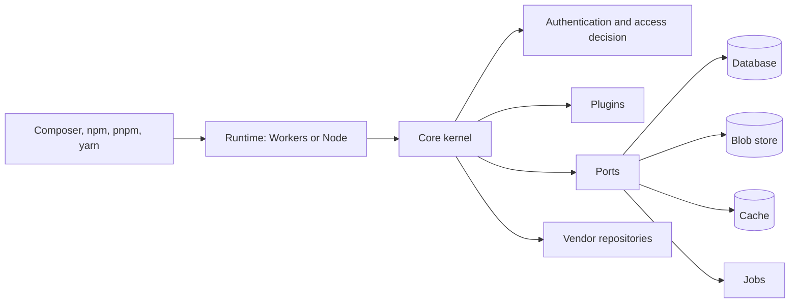

# Architecture overview

Package Broker serves Composer and npm registry documents and package archives, with a web interface for administration. This page describes the implementation merged on `main`.

<!-- source: packages/core/src/registry/composer/routes.ts:77 -->
<!-- source: packages/core/src/registry/npm/routes.ts:423 -->
<!-- source: packages/core/src/registry/dist-service.ts:263 -->
<!-- source: packages/ui/src/app.tsx:158 -->

<!-- source: packages/core/src/registry/module.ts:225 -->

## Two runtimes and a shared core

Package Broker runs on Cloudflare Workers or as a Node process, and both run the same core. `packages/core` holds the kernel, which is a Hono application, and defines ports for the database, blob store, cache, jobs, observability, identity and source providers. Each runtime supplies the platform adapters; plugins can bind the identity and source ports. `packages/runtime-cloudflare` binds D1, R2, the Cache API, Queues and Cron Triggers, and Workers Logs with optional Analytics Engine. `packages/runtime-node` binds `better-sqlite3`, a filesystem or S3-compatible blob store, an in-memory cache and a database-backed job loop. `packages/db-sqlite` holds the SQLite schema, repositories and migration runner that both runtimes share, along with database contract tests.

<!-- source: packages/core/src/kernel/kernel.ts:740 -->
<!-- source: packages/core/src/plugin.ts:66 -->
<!-- source: packages/runtime-cloudflare/src/index.ts:1009 -->
<!-- source: packages/runtime-cloudflare/src/index.ts:1366 -->
<!-- source: packages/runtime-node/src/startup.ts:533 -->
<!-- source: packages/runtime-node/src/startup.ts:570 -->
<!-- source: packages/runtime-node/src/startup.ts:602 -->

## Build-time composition of plugins

A deployment lists its plugins in `broker.config.ts`. `pb build` (`packages/cli`) validates the list, generates a static manifest with static imports, and bundles the entry point for the chosen runtime. Nothing is loaded at run time, and a plugin that is not listed is not in the bundle. A plugin declares its routes, hooks, jobs, migrations and the ports it supplies through `definePlugin` in `packages/core`. Plugins run in process and are trusted code that the operator reviews and pins. Authorization hooks can only deny: the core permission model grants access, so a hook cannot widen it.

<!-- source: packages/cli/src/build.ts:148 -->
<!-- source: packages/cli/src/build.ts:266 -->
<!-- source: packages/cli/src/build.ts:326 -->
<!-- source: packages/core/src/plugin.ts:97 -->
<!-- source: packages/core/src/kernel/authorize.ts:191 -->

The first-party plugins are `packages/plugin-sso-oidc` and `packages/plugin-github`. The SSO plugin supplies Cloudflare Access and OIDC identity providers. The GitHub plugin supplies a Composer source provider, GitHub App installation tokens, repository discovery and webhook verification.

<!-- source: packages/plugin-sso-oidc/src/index.ts:224 -->
<!-- source: packages/plugin-github/src/index.ts:28 -->
<!-- source: packages/plugin-github/src/index.ts:114 -->
<!-- source: packages/plugin-github/src/index.ts:211 -->

## Web interface

`packages/ui` implements browser pages for projects, access, sources, packages, tokens, audit events and imports, plus setup and sign-in. The kernel serves the interface at `/_pb/ui`. Static UI assets reach a build through `packages/ui-assets`, a build-time bridge: `pb build` imports the provider a deployment selects with `defineAssets` in its config and stages the files it lists beside the bundle. The bridge is never imported at run time.

<!-- source: packages/ui/src/app.tsx:58 -->
<!-- source: packages/core/src/kernel/ui-routes.ts:245 -->
<!-- source: packages/cli/src/build.ts:247 -->
<!-- source: packages/cli/src/build.ts:347 -->

## One organization per deployment, projects in the path

A deployment holds exactly one organization and many projects under it. Organization isolation is a deployment boundary: one Worker and database, or one container, per organization. Tenant-owned data and repository operations are scoped by organization. Registry endpoints include the project in the URL path: `/<project>/packages.json` and `/<project>/p2/...` for Composer, and `/<project>/npm/` for npm. This lets a developer keep one Composer credential for the broker host. Management and authentication routes use the reserved `/_pb` prefix. Path parsing lives in `packages/core/src/authz`, the repositories in `packages/db-sqlite`.

<!-- source: packages/core/src/kernel/org.ts:13 -->
<!-- source: packages/core/src/registry/composer/routes.ts:105 -->
<!-- source: packages/core/src/registry/npm/routes.ts:425 -->
<!-- source: packages/core/src/api/routes/tokens-schemas.ts:83 -->
<!-- source: packages/core/src/auth/routes-sso.ts:601 -->

## The request path

A request enters the kernel in `packages/core/src/kernel`. Routes declare a permission and boundary; supported boundaries are none, organization, project, package, self and authenticated. The kernel resolves the organization and principal, then asks the authorization engine in `packages/core/src/authz` for a decision. Access is granted through roles and grants to SSO groups or email addresses.

<!-- source: packages/core/src/plugin.ts:123 -->
<!-- source: packages/core/src/kernel/kernel.ts:554 -->
<!-- source: packages/core/src/kernel/kernel.ts:620 -->

Authentication supports browser sessions and two issued bearer token kinds: personal access tokens (`pb_pat_`) and service tokens (`pb_svc_`); `pb_cst_` is reserved and refused. At most one plugin binds the identity port, and that plugin can supply multiple configured providers. The first-party SSO plugin supports Cloudflare Access and OIDC sign-in. Local password and TOTP login is limited to administrators enrolled through the setup token.

<!-- source: packages/core/src/secrets/token-format.ts:3 -->
<!-- source: packages/core/src/secrets/token-format.ts:59 -->
<!-- source: packages/core/src/authz/token-use.ts:102 -->
<!-- source: packages/core/src/kernel/registry.ts:250 -->
<!-- source: packages/core/src/auth/local-login.ts:73 -->
<!-- source: packages/db-sqlite/src/kysely.ts:181 -->
<!-- source: packages/db-sqlite/src/repositories/admin-bootstrap.ts:361 -->

The registry and catalogue code in `packages/core/src/registry` and `packages/core/src/catalogue` builds documents from stored metadata and applies per-project visibility. Composer clients receive `packages.json` and p2 metadata; npm clients receive package and version metadata. Download URLs point back to the broker's archive routes.

<!-- source: packages/core/src/registry/composer/render.ts:256 -->
<!-- source: packages/core/src/registry/composer/dist-url.ts:65 -->
<!-- source: packages/core/src/registry/npm/render.ts:86 -->

## Ingest and vendor repositories

A source describes a vendor repository: Packagist, npm, a Composer repository such as Marketplace (`repo.magento.com`), or a Git repository. `packages/core/src/ingest` fetches and parses Composer and npm metadata, including Composer v1 provider indexes and v2 metadata. `packages/core/src/sources` defines the source provider port, credential handling and the Git client. Core handles plain Git and SSH repositories; the GitHub plugin adds GitHub App sources.

<!-- source: packages/core/src/ingest/composer/composer-repository.ts:52 -->
<!-- source: packages/core/src/ingest/composer/composer-repository.ts:138 -->
<!-- source: packages/core/src/ingest/composer/root.ts:523 -->
<!-- source: packages/core/src/ingest/vcs/git-provider.ts:300 -->
<!-- source: packages/core/src/api/routes/sources-schemas.ts:18 -->

The `hosted` source type is accepted by the API schema, but has no provider yet and is skipped by source synchronization.

<!-- source: packages/core/src/api/routes/sources-schemas.ts:9 -->
<!-- source: packages/core/src/sources/config.ts:6 -->
<!-- source: packages/core/src/sources/provider.ts:495 -->
<!-- source: packages/core/src/ingest/source-sync-job.ts:586 -->

Outbound source requests use a shared fetch policy. Private, loopback and link-local addresses are denied by default, credentials are bound to their origin and are not sent across a redirect to another origin, and response and archive sizes are bounded. On Node, an operator can allow named private hosts in deployment configuration only; Workers keeps the deny. The Node-side network guard is in `packages/runtime-node/src/sources`.

<!-- source: packages/core/src/sources/policy-fetch.ts:260 -->
<!-- source: packages/core/src/sources/url-policy.ts:193 -->
<!-- source: packages/runtime-node/src/sources/guarded-fetch.ts:103 -->

## Storage and jobs

The database is SQLite: D1 on Cloudflare and `better-sqlite3` on Node. Blobs are R2 on Cloudflare and the filesystem or an S3-compatible bucket on Node. The cache is the Cache API on Cloudflare and an in-memory LRU on Node. Blob keys include an organization segment; cache key digests include organization scope. Concurrent document and archive fills are coordinated through database leases. The adapters are in `packages/runtime-cloudflare` and `packages/runtime-node`; the shared schema and database contract tests are in `packages/db-sqlite`.

<!-- source: packages/core/src/platform/blob.ts:260 -->
<!-- source: packages/core/src/platform/cache.ts:129 -->
<!-- source: packages/core/src/registry/dist-service.ts:149 -->
<!-- source: packages/core/src/registry/module.ts:505 -->

The pull-through archive store checks package access before serving a stored archive or fetching a missing one. It verifies fetched archives before storing them and coordinates concurrent fills with a lease scoped by organization, version and revision.

<!-- source: packages/core/src/registry/dist-service.ts:178 -->
<!-- source: packages/core/src/registry/dist-service.ts:233 -->
<!-- source: packages/core/src/registry/dist-service.ts:272 -->
<!-- source: packages/core/src/registry/dist-service.ts:286 -->

Jobs use Queues and Cron Triggers on Cloudflare and a leased job table polled by a loop on Node. Background work includes ingest, package synchronization, audit sealing and verification, and imports.

<!-- source: packages/runtime-cloudflare/src/index.ts:1470 -->
<!-- source: packages/runtime-cloudflare/src/index.ts:1510 -->
<!-- source: packages/core/src/registry/jobs.ts:19 -->
<!-- source: packages/runtime-cloudflare/src/index.ts:1715 -->
<!-- source: packages/runtime-cloudflare/src/index.ts:1748 -->
<!-- source: packages/runtime-node/src/index.ts:1139 -->

## Observability

One observability port in `packages/core/src/platform` covers logs, metrics and traces. Node writes JSON logs to standard output, and Cloudflare uses Workers Logs with optional Analytics Engine metrics. Both can export logs, metrics and traces over OTLP without a vendor SDK. Each HTTP request emits a server span when trace export is configured.

<!-- source: packages/runtime-node/src/startup.ts:408 -->
<!-- source: packages/core/src/platform/completion-span.ts:5 -->

Source requests emit `upstream.fetch` client spans when a parent trace context is available; see [Observability](operations/observability.md) for tracing behavior and configuration.

<!-- source: packages/core/src/sources/policy-fetch.ts:446 -->
<!-- source: packages/core/src/platform/tracing.ts:84 -->
