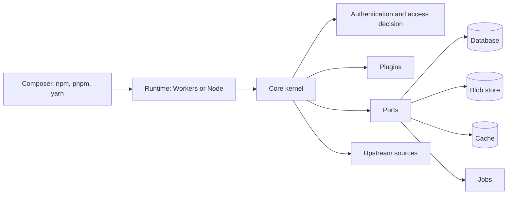

# Architecture overview

This page describes how Package Broker is put together, as merged on `main`. Registry document serving, the web interface and the first-party plugins are still being built; where a section describes a building block rather than a finished feature, it says so.

## Two runtimes and a shared core

Package Broker runs on Cloudflare Workers or as a Node process, and both run the same code. `packages/core` holds the kernel, which is a Hono application, and depends only on ports: database, blob store, cache, jobs, observability, identity and source provider. Each runtime supplies the adapters. `packages/runtime-cloudflare` binds D1, R2, the Cache API, Queues and Cron Triggers, and Workers Logs with Analytics Engine. `packages/runtime-node` binds `better-sqlite3`, a filesystem or S3-compatible blob store, an in-memory cache and a database-backed job loop. `packages/db-sqlite` holds the SQLite schema, repositories and migration runner that both runtimes share, along with the contract tests each adapter must pass.

## Build-time composition of plugins

A deployment lists its plugins in `broker.config.ts`. `pb build` (`packages/cli`) validates the list, generates a static manifest with static imports, and bundles the entry point for the chosen runtime. Nothing is loaded at run time, and a plugin that is not listed is not in the bundle. A plugin declares its routes, hooks, jobs, migrations and the ports it supplies through `definePlugin` in `packages/core`. Plugins run in process and are trusted code that the operator reviews and pins. Hooks can only deny: the core permission model is the only place that grants access, so a hook cannot widen it. The first-party plugins are `packages/plugin-sso-oidc` and `packages/plugin-github`; the GitHub plugin is a stub for now. Static UI assets reach a build through `packages/ui-assets`, a build-time bridge: `pb build` imports the provider a deployment selects with `defineAssets` in its config and stages the files it lists beside the bundle. The bridge is never imported at run time.

## One organization per deployment, projects in the path

A deployment holds exactly one organization and many projects under it. Customer isolation is a deployment boundary, not a runtime switch: one Worker and database, or one container, per customer. The `org_id` column is still on every tenant-owned table and every repository method takes an organization context, so that no query can cross the boundary. The project is part of the URL path on every endpoint, `/<project>/...` for Composer and `/<project>/npm/` for npm, which lets a developer keep one Composer credential for the broker host. Path parsing lives in `packages/core/src/authz`, the repositories in `packages/db-sqlite`.

## The request path

A request enters the kernel in `packages/core/src/kernel`. Routes are declared with a permission and a boundary (none, organization, project, package or self), and the kernel resolves the organization, then the principal, then asks the authorization engine in `packages/core/src/authz` for a decision. Authentication in `packages/core/src/auth` covers local administrator login with TOTP, OIDC single sign-on and bearer tokens. Access is granted through roles and grants to SSO groups or email addresses. The registry endpoint and catalogue code in `packages/core/src/registry` and `packages/core/src/catalogue` build Composer and npm documents from stored metadata and apply per-project visibility. The routes that serve those documents to clients are not merged yet.

## Ingest and upstream sources

A source is where packages come from: Packagist, npm, GitHub and other Git hosts. `packages/core/src/ingest` fetches and parses Composer and npm metadata, and `packages/core/src/sources` holds the source provider port, credential handling and the Git client. Every outbound request goes through one fetch policy. Private, loopback and link-local addresses are denied, credentials are bound to their origin and are not sent across a redirect to another origin, and response and archive sizes are bounded. On Node, an operator can allow named private hosts in deployment configuration only; Workers keeps the deny. The Node-side guard is in `packages/runtime-node/src/sources`.

## Storage

The database is SQLite: D1 on Cloudflare and `better-sqlite3` on Node. Blobs are R2 on Cloudflare and the filesystem or an S3-compatible bucket on Node. The cache is the Cache API on Cloudflare and an in-memory LRU on Node. Jobs are Queues with Cron Triggers on Cloudflare and a leased job table polled by a loop on Node. Concurrent fills of one upstream document are coordinated through database leases. Blob and cache keys carry an organization segment. The adapters are in `packages/runtime-cloudflare` and `packages/runtime-node`; the shared schema and contract tests are in `packages/db-sqlite`.

## Observability

One observability port in `packages/core/src/platform` covers logs, metrics and traces. Node writes JSON logs to standard output, and Cloudflare uses Workers Logs and Analytics Engine. Both can export logs, metrics and traces over OTLP, so any OTLP backend works without a vendor SDK. Requests are traced, upstream fetches are child spans, and the `traceparent` header is propagated.
